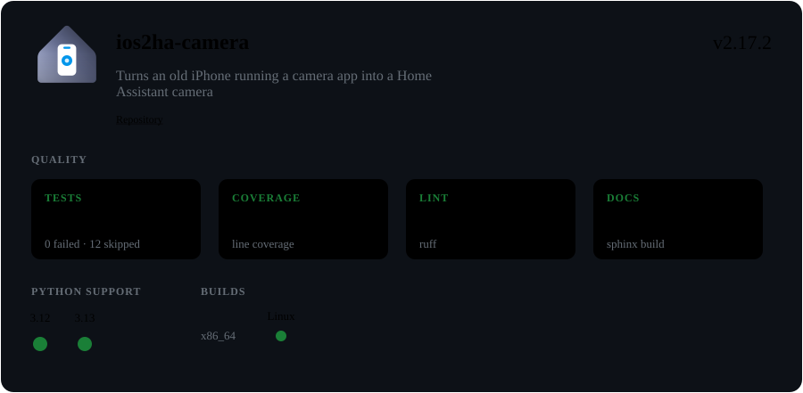

<!-- ghtools:sync status START — generated from the status branch, do not edit here -->



<!-- ghtools:sync status END -->


An iPhone, permanently pointed out of a window, turned into a dependable Home Assistant camera.

A supervisor service runs on a Linux host and is the **only** client of the phone. It holds one
MJPEG connection, buffers the frames, and every ten minutes stacks a set of them into a single
still whose depth rises as the light falls — so a night frame that is almost pure noise becomes a
usable photograph. Stills go to Home Assistant over MQTT and to a dated archive on disk. The
service also re-serves the live stream, drives the camera's autofocus, reads the phone's battery
over USB, and reports its own health.

## Why it works this way

The previous arrangement pointed Home Assistant's MJPEG proxy straight at the phone. One stalled
viewer froze the phone's entire HTTP server; stalls accumulated until the phone ran out of kernel
mbufs and it **kernel-panicked at 02:00 on 1 September 2026**. Nothing noticed. The timelapse simply
stopped, and stayed stopped for eleven days.

Three rules follow from that, and most of the design is downstream of them:

1. **Exactly one client ever touches the phone.** Home Assistant talks to the supervisor, never to
   the camera. A slow viewer can stall only its own connection.
2. **Never churn connections.** Rapid connect/close wedges the app until someone restarts it by
   hand. Every reconnect backs off, even after a clean disconnect.
3. **Failure is loud.** Health is published on its own short tick, availability rides a last-will
   topic, and Home Assistant alerts when the stream stops, the disk fills, the phone overheats or
   the battery drains.

## Layout

```
 iPhone (Guardian Eye, on the LAN)
   │  one MJPEG connection, opened on demand │  ONVIF SOAP        │  Lightning USB (management only)
   ▼                                         ▼                    ▼
 supervisor  (Docker container on the LAN host)
   upstream ── decides when the phone is connected; holds it for a capture or a viewer
   ingest ─── ring buffer of compressed frames
     ├── live re-serve        →  /live, /live/stacked and /still.jpg
     ├── stacker              →  sigma-clipped mean, depth from measured light
     ├── render               →  black level, white balance, tone map
     ├── outputs              →  MQTT still + events + state, dated JPEG archive
     └── health               →  stream state, frame time, battery, disk
   │  MQTT
   ▼
 Home Assistant  — camera, 60-odd entities, timelapse automation, alerts
```

## On demand

The supervisor used to hold its one MJPEG connection to the phone open for the life of the
process. That costs about 300 mA continuously, and on the 3 W USB port this installation runs
from it flattened the phone in about six hours. The connection is now something anything needing
frames *takes* and *gives back*: a capture holds it just long enough to fill its window, a live
viewer holds it for as long as they watch (plus a 30 s linger, so a quick reconnect doesn't cause a
reprobe), and while nothing holds it the phone is probed every 60 s — connect, read one frame,
close — for about 2–3 mA a minute. Opening the connection costs little in latency either: the first
frame arrives about 113 ms after connecting. `switch.ios2ha_camera_on_demand` turns this off and
goes back to the old always-connected behaviour, if you ever need to compare the two.

`/live/stacked` gets the same treatment: its noise-reduced feed only runs while someone is actually
watching it, so the CPU cost of stacking a live feed is paid on demand too, not continuously.

After a phone restart, `./deploy.sh phone` (or the **Prepare phone** button) puts the phone back
into a state where it can stream — checking lockdown, Developer Mode and the developer disk image,
and relaunching the app — short of the one thing that can't be automated: tapping Start streaming.

## Getting started

```bash
python3 -m venv ~/.venvs/ios2ha-camera
~/.venvs/ios2ha-camera/bin/pip install -e '.[dev]'
~/.venvs/ios2ha-camera/bin/pytest -q          # no hardware needed
~/.venvs/ios2ha-camera/bin/ruff check .
```

The whole test suite runs against a fake camera that serves real JPEGs over real sockets, so
nothing here needs a phone. Those same two commands, plus a `docker build`, are what CI runs on
every push.

To run it for real, see **[OPERATIONS.md](OPERATIONS.md)**. To change it, see
**[CONTRIBUTING.md](CONTRIBUTING.md)**.

Once it runs, open the service's address in a browser (`http://<host>:8099/`) for its control
page: every setting and reading Home Assistant has, with what each one does, live, and the picture.
It is a plain client of the JSON API, so it is there exactly when `EXPOSE_API` is on.

## The documentation

| Document | What is in it |
|---|---|
| **[ARCHITECTURE.md](ARCHITECTURE.md)** | Every module, what it does, and the decisions that are not obvious from the code — the threading model, the depth law, how stacking stays within memory |
| **[CONFIGURATION.md](CONFIGURATION.md)** | Every control and every sensor, with units, defaults and which knob to reach for |
| **[OPERATIONS.md](OPERATIONS.md)** | Deploying, versioning, reading the logs, the alerts, and the device quirks that will otherwise cost you an evening |
| **[CHANGELOG.md](CHANGELOG.md)** | Releases, and what a major, minor or patch version means for your automations |
| **[CONTRIBUTING.md](CONTRIBUTING.md)** | Running the tests, the commit convention, and how a change becomes a version |

There is also a Sphinx site under `docs/`, built on every pull request. It includes the files
above rather than copying them, and adds the parts that suit a browsable site better — the API
reference, and the promises made about the Home Assistant surface.

## What it produces

A 1920×1080 JPEG every ten minutes, stacked from between one and six hundred frames depending on
the light, rendered either as a natural photograph or as a deliberately garish inspection stretch.
Roughly 20–65 MB a day of archive. Alongside that, about sixty Home Assistant entities covering the
scene (luminance percentiles, colour temperature, dynamic range, motion, focus sharpness), the
capture (depth used and required, effective exposure, capture duration), and the hardware (battery
level, current, temperature, charger power, cell health, free disk).

## Status

Built, reviewed, and verified against the real device: stills stacking and archiving, ONVIF
autofocus toggling, battery over USB, the live feed re-served, and the offline alert firing five
minutes after the camera app was closed.

Known limits of the phone app itself, all measured rather than assumed, are listed in
[OPERATIONS.md](OPERATIONS.md#what-the-phone-will-and-will-not-do).
